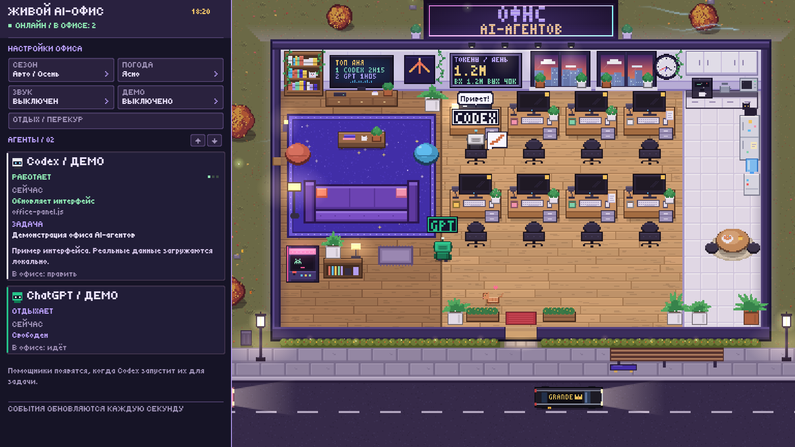

# Офис AI-агентов

Живые пиксельные обои для Wallpaper Engine: Codex, ChatGPT и настоящие подагенты Codex. Русский интерфейс, локальные статусы, дневной рейтинг, счётчик токенов и общий перерыв у здания.



## Запуск

Нужны Windows, работающий Wallpaper Engine и Python 3.10+ с `python.exe` в PATH. API-ключ не требуется.

Скачайте репозиторий в постоянную папку, откройте в ней PowerShell:

```powershell
powershell.exe -NoProfile -ExecutionPolicy Bypass -File .\install-office.ps1
powershell.exe -NoProfile -ExecutionPolicy Bypass -File .\apply-wallpaper.ps1
```

Первый скрипт запускает локальный мост и создаёт ярлык автозапуска Windows. Второй копирует обои в локальные проекты Wallpaper Engine и включает их на первом мониторе. Откройте Codex и отправьте задачу: статусы появятся автоматически. Подагенты появляются только при их настоящем запуске.

Настройки закреплены сверху. Кнопка **Отдых / перекур** отправляет персонажей на минуту к фасаду; повторное нажатие возвращает их. Работа Codex при этом продолжается.

## Данные

Мост слушает только `127.0.0.1:7777` и читает историю Codex в режиме только чтения. Текущие задачи и короткие публичные сведения об операциях доступны только локально. Скрытые рассуждения и результаты инструментов не извлекаются.

Рейтинг считает время задач за текущий московский день. Токены берутся из записей расхода локальных сессий Codex, включая кэш без повторного сложения. Для ChatGPT доступна только приблизительная активность отдельного приложения; его сообщения и токены не считываются. Формат внутренних баз Codex может измениться после обновления приложения.

Подробнее: [инструкция на русском](README-RU.md).

## Проверка

```powershell
python -m unittest discover -s tests -v
```

## Отключение

```powershell
powershell.exe -NoProfile -ExecutionPolicy Bypass -File .\uninstall-office.ps1
```

Скрипт останавливает мост и удаляет ярлык автозапуска, сохраняя обои и исходники.

## Авторство

Основано на [TheGrandees AI Office](https://github.com/AlexanderGrandees/thegrandees-ai-office), MIT. Добавлены русская локализация, подключение Codex и его подагентов, пиксельная панель управления, дневная статистика и зона отдыха. Лицензия шрифта — [OFL](fonts/OFL.txt).
